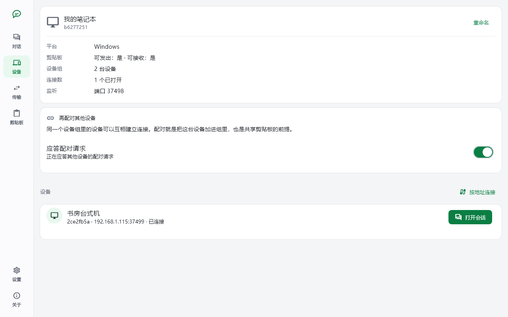
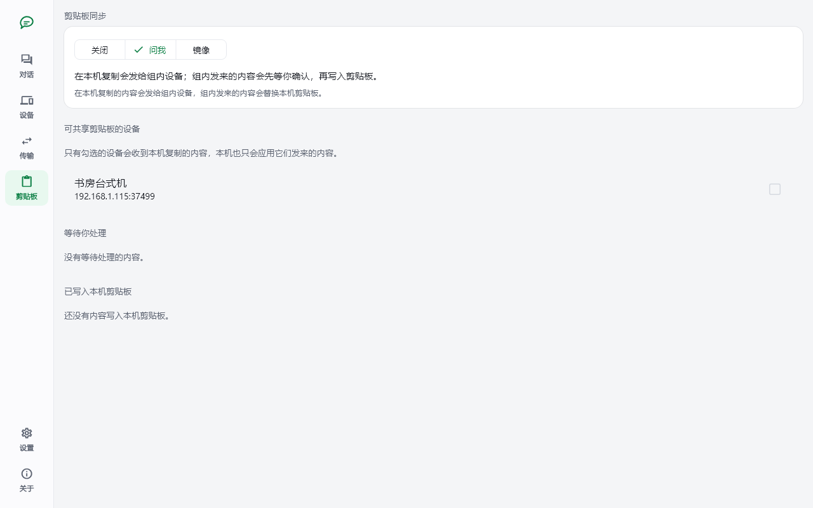
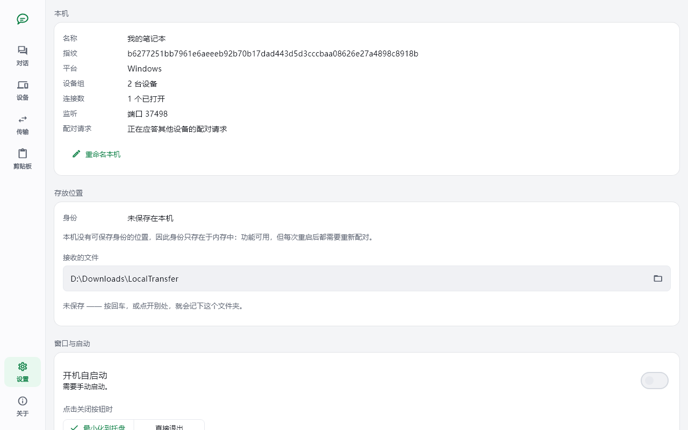

# 局域网传输工具（Local Transfer）

一款点对点的局域网传输工具，用于在局域网内的设备之间传输文本、文件和剪贴板内容。无需服务器、无需账号、无需云端。

- 支持平台（v1）：Windows、Android
- 产品术语表：[CONTEXT.md](CONTEXT.md)
- 仓库约定（分支、提交、质量门禁）：[AGENTS.md](AGENTS.md)
- 架构与平台决策：[.agents/notes/](.agents/notes/)
- 基于真实硬件验证的平台事实：[docs/](docs/)

## 截图

以下截图由 `tool/screenshots/capture_screenshots.dart` 驱动真实的界面代码生成，图片存放在
[`docs/screenshots/`](docs/screenshots/)。截图中的设备名、IP 地址与端口均为示例。









## 开发

开发环境需要当前稳定版 Flutter（3.47.x / Dart 3.13.x）。

常用命令：

```sh
flutter pub get
flutter analyze
dart format --set-exit-if-changed .
dart test
flutter test test_flutter
```

`test/` 里是不需要 widget 树的纯 Dart 测试，由 `dart test` 跑起来；`test_flutter/` 里是导入
`package:flutter_test` 的 widget 测试，由 `flutter test test_flutter` 跑起来。门禁的划分见
[AGENTS.md](AGENTS.md#5-门禁)。

Windows 和 Android 调试构建检查：

```sh
flutter build windows --debug
flutter build apk --debug
```
