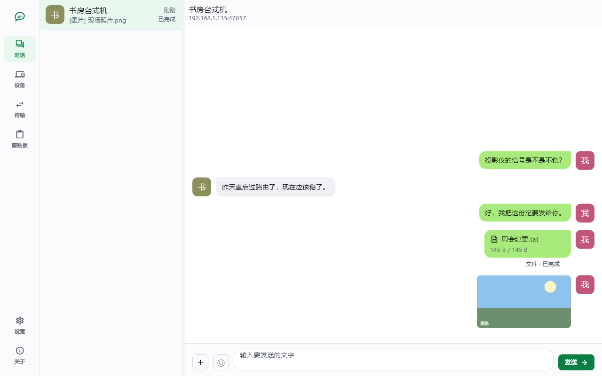
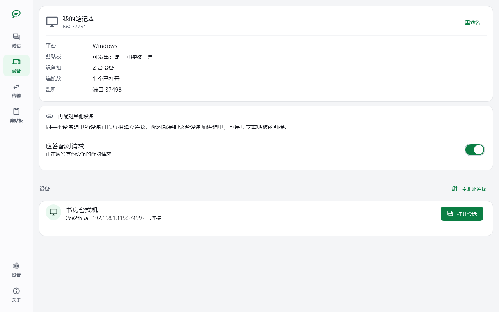
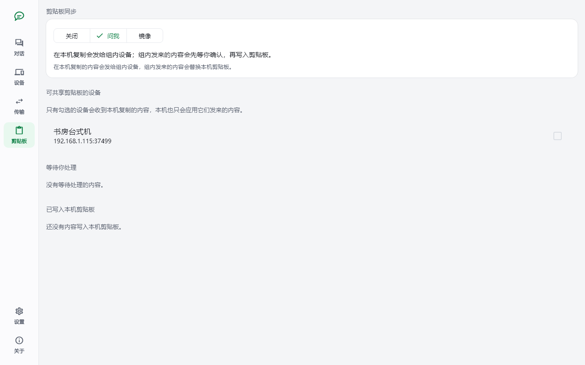
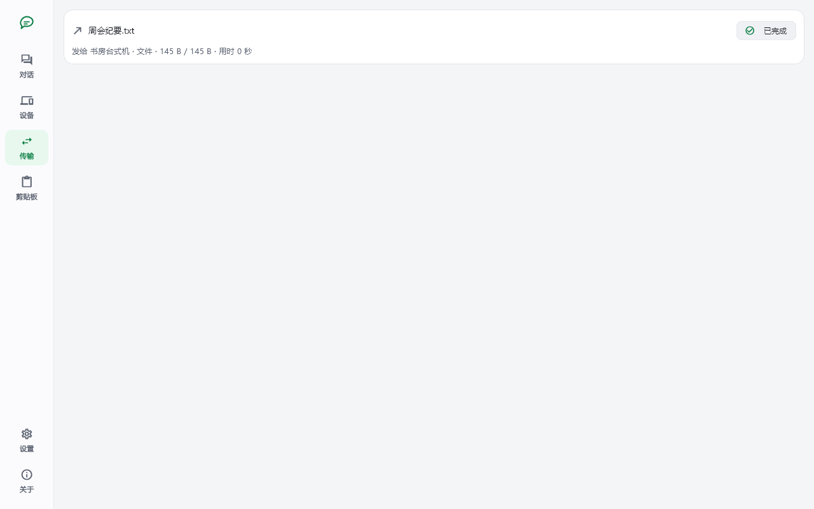
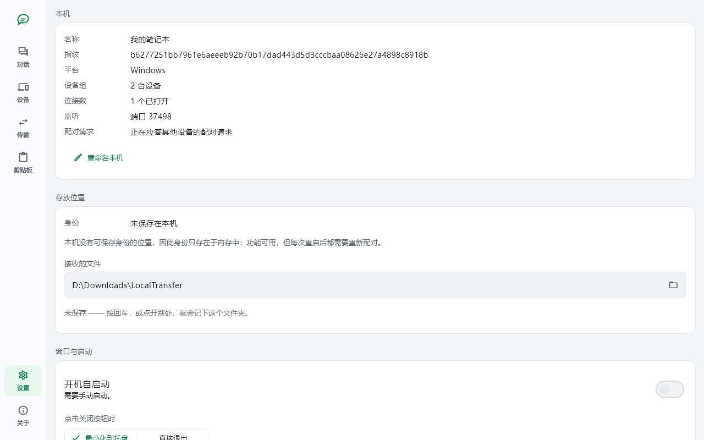

# 局域网传输工具（Local Transfer）

一款点对点的局域网传输工具，用于在局域网内的设备之间传输文本、文件和剪贴板内容。无需服务器、无需账号、无需云端。

- 支持平台（v1）：Windows、Android
- 产品术语表：[CONTEXT.md](CONTEXT.md)
- 仓库约定（分支、提交、质量门禁）：[AGENTS.md](AGENTS.md)
- 架构与平台决策：[.agents/notes/](.agents/notes/)
- 基于真实硬件验证的平台事实：[docs/](docs/)
- 官网与下载：[site/](site/)（部署在 GitHub Pages）

## 功能概览

- **局域网直连**：UDP 广播自动发现，TCP 直连传数据；发现不到时可以手动填 IP 连接。
  装了 Tailscale 的设备之间也能互相发现（tailnet 不过广播，改走单播探测）。
- **发现即自动连接**：同一局域网里运行本程序的设备被发现后自动建立设备组信任并打开
  会话，没有配对码、没有接受请求；断网重连也自动恢复。
- **对话**：微信式双栏界面，文字、图片、文件、表情在同一处收发；会话记录持久化到磁盘，
  支持搜索、未读标记、逐条删除与清空/删除整个会话。
- **文件与图片**：文字和图片到达即送达；文件每次都要对方点「接收」才落盘，落在可配置的
  接收目录，支持断点续传。
- **剪贴板镜像**：同一设备组内把复制内容同步到另一台设备，分「关闭 / 问我 / 镜像」三档，
  按设备逐个勾选，界面如实标注每台设备的读写能力。
- **截图工具（仅 Windows）**：全局快捷键呼出截图遮罩，支持框选、窗口与全屏截图，
  可标注（箭头、矩形、画笔、文字、序号）、复制、钉图与历史记录；默认开启，快捷键可自定义。
- **应用内更新**：启动时查一次 GitHub 发布版本，之后按设置的频率（默认每小时，可关）
  继续查；发现新版本可在应用内下载、校验并一键更新重启。
- **桌面细节**：单实例、关闭最小化到托盘或直接退出、可开机自启、深色模式跟随系统。

与外界的唯一通信是向 GitHub 询问发布版本，不发送任何内容；其余流量全部在本局域网内。

## 截图

以下截图由 `tool/screenshots/capture_screenshots.dart` 驱动真实的界面代码生成，图片存放在
[`docs/screenshots/`](docs/screenshots/)。截图中的设备名、IP 地址与端口均为示例。











## 开发

开发环境需要当前稳定版 Flutter（3.47.x / Dart 3.13.x）。

常用命令：

```sh
flutter pub get
flutter analyze
dart format --set-exit-if-changed .
dart test
flutter test test_flutter
```

`test/` 里是不需要 widget 树的纯 Dart 测试，由 `dart test` 跑起来；`test_flutter/` 里是导入
`package:flutter_test` 的 widget 测试，由 `flutter test test_flutter` 跑起来。门禁的划分见
[AGENTS.md](AGENTS.md#5-门禁)。

Windows 和 Android 调试构建检查：

```sh
flutter build windows --debug
flutter build apk --debug
```

## 反馈问题或建议

遇到问题或有建议，欢迎加入 QQ 交流群：[QQ交流群](https://qm.qq.com/q/rpttgcx0MC)
